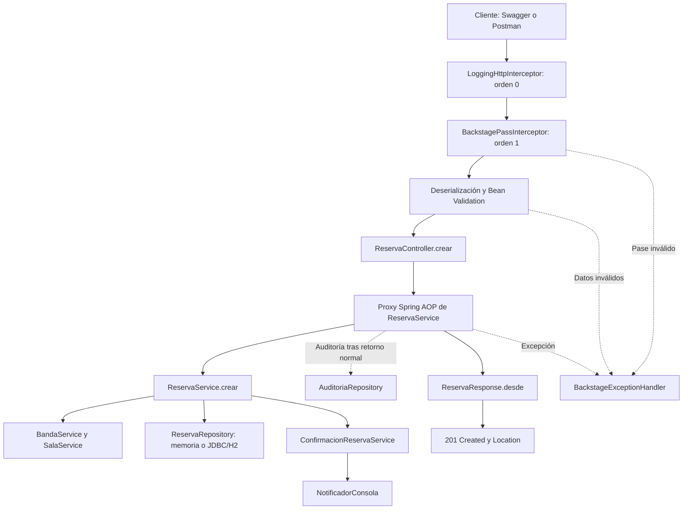

# 🎸 Backstage — Alquiler de salas de ensayo

API REST para registrar bandas, administrar salas musicales y gestionar reservas con Spring Boot. Su regla principal es **un máximo de seis horas confirmadas por banda y fecha**, sumando todas las salas.

**Repositorio:** [NoeliaMendoza/backstage-salas-ensayo](https://github.com/NoeliaMendoza/backstage-salas-ensayo)

Proyecto académico de Programación Avanzada que integra IoC/DI, interceptores web, AOP, Bean Validation y manejo global de excepciones. Incluye H2 como persistencia opcional y Swagger/OpenAPI para probar los endpoints.

## Contenido

- [Funcionalidades](#funcionalidades)
- [Tecnologías y requisitos](#tecnologías-y-requisitos)
- [Instalación y ejecución](#instalación-y-ejecución)
- [Configuración y persistencia](#configuración-y-persistencia)
- [Swagger y acceso](#swagger-y-acceso)
- [Modelo y reglas de negocio](#modelo-y-reglas-de-negocio)
- [Endpoints REST](#endpoints-rest)
- [Ejemplo completo](#ejemplo-completo)
- [Arquitectura y conceptos de Spring](#arquitectura-y-conceptos-de-spring)
- [Validaciones y errores](#validaciones-y-errores)
- [Pruebas automatizadas](#pruebas-automatizadas)
- [Mejora del contrato HTTP](#mejora-del-contrato-http)
- [Evidencias y documentación](#evidencias-y-documentación)
- [Solución de problemas](#solución-de-problemas)
- [Alcance y limitaciones](#alcance-y-limitaciones)

## Funcionalidades

- Registrar bandas con código único y formato `BAND-1234`.
- Registrar salas con capacidad, tarifa por hora y descripción del equipo.
- Consultar públicamente las salas y la cartelera.
- Crear, consultar y cancelar reservas; listarlas por banda y fecha.
- Evitar horarios superpuestos y comprobar la capacidad de las salas.
- Aplicar el límite diario de ensayo mediante un aspecto.
- Registrar tiempos HTTP y de servicios, y auditar operaciones exitosas.
- Validar el pase compartido `X-Backstage-Pass`.
- Elegir almacenamiento en memoria o H2 en archivo mediante un perfil.
- Probar la API con Swagger, Postman o [solicitudes.http](solicitudes.http).

## Tecnologías y requisitos

| Componente | Uso |
|---|---|
| Java 17 o superior | Versión mínima del proyecto; verificado con JDK 21 |
| Spring Boot 4.1.1 | Configuración y ejecución |
| Spring Web MVC | Controladores y API REST |
| Jakarta Bean Validation | Restricciones de entrada y validación personalizada |
| Spring AOP y AspectJ | Logging, auditoría y límite diario |
| Spring JDBC | Persistencia con `JdbcTemplate` |
| H2 | Base de datos local opcional |
| springdoc-openapi 3.1.1 | OpenAPI y Swagger UI |
| Spring Mail | Notificador opcional por correo |
| JUnit y Spring Boot Test | Pruebas de contexto, HTTP y persistencia |
| Maven Wrapper | Compilación y ejecución sin instalar Maven por separado |

Se necesita Git para clonar e internet en la primera ejecución para descargar Maven y las dependencias. El modo predeterminado no requiere instalar una base de datos ni un servidor SMTP.

## Instalación y ejecución

### 1. Clonar y comprobar Java

```powershell
git clone https://github.com/NoeliaMendoza/backstage-salas-ensayo.git
cd backstage-salas-ensayo
java -version
```

### 2. Elegir el almacenamiento

| Modalidad | Activación | Datos al reiniciar |
|---|---|---|
| Memoria | Sin perfil `h2` | Se pierden |
| H2 en archivo | Perfil `h2` | Se conservan en `data/backstage.mv.db` |

**Modo en memoria**, que conserva el almacenamiento solicitado en la actividad original:

```powershell
.\mvnw.cmd spring-boot:run
```

**Modo H2**, para guardar bandas, salas, reservas y auditoría:

```powershell
.\mvnw.cmd spring-boot:run "-Dspring-boot.run.profiles=h2"
```

En macOS/Linux:

```bash
./mvnw spring-boot:run
./mvnw spring-boot:run -Dspring-boot.run.profiles=h2
```

Si el sistema indica que el wrapper no tiene permiso de ejecución, ejecutar `chmod +x mvnw`.

### 3. Acceder

- Cartelera pública: <http://localhost:8080/public/cartelera>
- Swagger UI: <http://localhost:8080/swagger-ui.html>
- OpenAPI JSON: <http://localhost:8080/v3/api-docs>

El puerto predeterminado es `8080`. Detener la aplicación con `Ctrl+C`.

### Desde IntelliJ IDEA

Abrir como proyecto Maven, seleccionar un JDK compatible y ejecutar `ActividadApplication`. Para H2, añadir `--spring.profiles.active=h2` a los argumentos del programa, o establecer `h2` como perfil activo de Spring Boot.

### Generar y ejecutar el JAR

```powershell
.\mvnw.cmd package
java -jar target/Actividad-0.0.1-SNAPSHOT.jar --spring.profiles.active=h2
```

Omitir el argumento del perfil para utilizar memoria.

## Configuración y persistencia

Archivos: [application.properties](src/main/resources/application.properties) y [application-h2.properties](src/main/resources/application-h2.properties).

| Propiedad | Valor local | Propósito |
|---|---|---|
| `backstage.pase` | `${BACKSTAGE_PASS:ROCK-LOCAL-2027}` | Pase compartido configurable por variable de entorno |
| `backstage.zona` | `America/Guayaquil` | Reloj del dominio, validación y auditoría |
| `backstage.max-horas-diarias` | `6` | Límite obligatorio del dominio |
| `spring.mail.host` | `localhost` | Servidor SMTP opcional |
| `spring.mail.port` | `1025` | Puerto SMTP local |
| `backstage.datasource.url` | `jdbc:h2:file:./data/backstage` | Archivo H2 |
| `springdoc.swagger-ui.path` | `/swagger-ui.html` | Documentación interactiva |

`PoliticaEnsayo` exige exactamente seis horas; otro valor impide el arranque. `H2Config` configura la base solo con el perfil `h2`. La autoconfiguración de `DataSource` se deshabilita para conservar las colecciones en el modo predeterminado.

El esquema [schema-h2.sql](src/main/resources/db/schema-h2.sql) crea tablas e índices si no existen e incluye claves foráneas de reservas a bandas y salas. Los cuatro repositorios de `repository/jdbc` utilizan SQL. **H2 está implementado mediante JDBC, sin JPA.**

La ruta del archivo es relativa al directorio de ejecución. Iniciar siempre desde la raíz del proyecto permite reutilizar la misma base. `data/` está excluido de Git. No hay consola web de H2.

Para cambiar el pase antes de iniciar, en PowerShell:

```powershell
$env:BACKSTAGE_PASS = "MI-PASE-LOCAL"
```

### Notificaciones

`ConfirmacionReservaService` selecciona `notificadorConsola` mediante `@Qualifier`; funciona sin servicios externos. Para usar `notificadorCorreo`, cambiar el qualifier y configurar un servidor SMTP disponible. El envío real requiere esa configuración; las pruebas registradas no acreditan un envío de correo. Un fallo de notificación se registra y no deshace la reserva.

## Swagger y acceso

1. Iniciar la aplicación y abrir Swagger UI.
2. Pulsar **Authorize**.
3. Introducir `ROCK-LOCAL-2027`, o el valor configurado en `BACKSTAGE_PASS`, sin prefijos.
4. Confirmar y cerrar el diálogo.
5. Elegir una operación, pulsar **Try it out**, completar los datos y pulsar **Execute**.

OpenAPI declara un API key en el header `X-Backstage-Pass`. La cartelera y las consultas GET de salas son públicas. Registrar una sala sí exige pase.

El pase es un mecanismo didáctico compartido: no identifica a una persona ni implementa cuentas o roles individuales.

## Modelo y reglas de negocio

| Entidad | Atributos |
|---|---|
| `Banda` | `id`, `codigo`, `nombre`, `generoMusical`, `correoRepresentante`, `numeroIntegrantes`, `activa` |
| `Sala` | `id`, `nombre`, `capacidad`, `tarifaHora`, `descripcionEquipo`, `habilitada` |
| `Reserva` | `id`, `bandaId`, `salaId`, `fecha`, `horaInicio`, `duracionHoras`, `total`, `estado`, `creadaEn` |

Cada reserva relaciona una banda con una sala. Ambas pueden tener varias reservas. Los identificadores son UUID, los importes usan `BigDecimal` y los modelos son records inmutables.

Reglas implementadas:

- Máximo **seis horas confirmadas por banda y fecha**, entre todas las salas. Exactamente seis está permitido.
- Las canceladas no consumen cupo; cancelar nuevamente conserva `CANCELADA`.
- Cada reserva dura entre una y seis horas enteras y comienza en una hora exacta.
- La fecha no puede ser anterior al día actual del reloj configurado.
- El ensayo puede terminar a medianoche, pero no cruzarla.
- No se permiten reservas confirmadas superpuestas de una misma sala. Los horarios consecutivos sí están permitidos.
- La banda debe estar activa, la sala habilitada y la capacidad debe admitir a los integrantes.
- El total es `tarifaHora × duracionHoras`.
- El código de banda es único y sigue el formato `BAND-1234`.

## Endpoints REST

| Método | Ruta | Descripción | Acceso | Éxito |
|---|---|---|---|---|
| GET | `/public/cartelera` | Presentación y salas habilitadas | Público | 200 |
| POST | `/api/bandas` | Registrar banda | Pase | 201 |
| GET | `/api/bandas/{id}` | Consultar banda | Pase | 200 |
| GET | `/api/bandas/{id}/reservas?fecha=2027-05-20` | Reservas de la banda por fecha | Pase | 200 |
| POST | `/api/salas` | Registrar sala | Pase | 201 |
| GET | `/api/salas` | Listar salas habilitadas | Público | 200 |
| GET | `/api/salas/{id}` | Consultar sala | Público | 200 |
| POST | `/api/reservas` | Crear reserva | Pase | 201 |
| GET | `/api/reservas/{id}` | Consultar reserva | Pase | 200 |
| PATCH | `/api/reservas/{id}/cancelacion` | Cancelar reserva | Pase | 200 |

Las creaciones incluyen `Location` con la ruta del recurso creado. El listado por banda exige `fecha` en formato `AAAA-MM-DD`.

## Ejemplo completo

Ejecutar manualmente desde Swagger o Postman. Las solicitudes protegidas requieren el header del pase; los cuerpos JSON usan `Content-Type: application/json`.

```http
X-Backstage-Pass: ROCK-LOCAL-2027
Content-Type: application/json
```

No se precargan datos. Usar UUID reales de las respuestas y una fecha futura al realizar la demostración.

### 1. Registrar banda

`POST /api/bandas`

```json
{
  "codigo": "BAND-2048",
  "nombre": "Los Acordes Perdidos",
  "generoMusical": "Rock",
  "correoRepresentante": "acordes@example.com",
  "numeroIntegrantes": 4
}
```

Resultado esperado: `201 Created`. Copiar el `id` como `bandaId`. Si el código ya existe en H2, elegir otro código válido de cuatro dígitos.

### 2. Registrar sala

`POST /api/salas`

```json
{
  "nombre": "Escenario Violeta",
  "capacidad": 6,
  "tarifaHora": 12.50,
  "descripcionEquipo": "Batería, dos amplificadores y tres micrófonos"
}
```

Resultado esperado: `201 Created`. Copiar el `id` como `salaId`.

### 3. Reservar cuatro horas

`POST /api/reservas`

```json
{
  "bandaId": "146ae3bc-75e2-49c2-9db2-998a09cf8d30",
  "salaId": "f84acd9e-ceaf-450c-a274-1b71695b8fe4",
  "fecha": "2027-05-20",
  "horaInicio": "10:00:00",
  "duracionHoras": 4
}
```

Reemplazar los UUID ilustrativos por los creados. Ejemplo ilustrativo de respuesta `ReservaResponse`, con tarifa de 12,50 y total de 50,00:

```json
{
  "id": "9e5af932-7523-4931-81d0-9da47cbde0ef",
  "bandaId": "146ae3bc-75e2-49c2-9db2-998a09cf8d30",
  "salaId": "f84acd9e-ceaf-450c-a274-1b71695b8fe4",
  "fecha": "2027-05-20",
  "horaInicio": "10:00:00",
  "duracionHoras": 4,
  "total": 50.00,
  "estado": "CONFIRMADA",
  "creadaEn": "2026-10-23T15:00:00Z"
}
```

### 4. Comprobar el límite

Repetir la creación con la misma banda y fecha, inicio `14:00:00` y duración `3`. Si la reserva de cuatro horas sigue confirmada, se espera `409`, código `LIMITE_ENSAYO_EXCEDIDO`, porque el total sería siete.

Con duración `2`, el total será exactamente seis y debe aceptarse si el horario está libre.

### 5. Consultar y cancelar

```http
GET /api/reservas/{reservaId}
GET /api/bandas/{bandaId}/reservas?fecha=2027-05-20
PATCH /api/reservas/{reservaId}/cancelacion
```

Sustituir los parámetros por los identificadores reales y enviar el pase. Cancelar devuelve `estado: "CANCELADA"` y libera las horas del cupo diario.

## Arquitectura y conceptos de Spring



El proxy agrupa logging de servicios, límite diario y auditoría. No se configura `@Order` entre los aspectos: el diagrama no fija un orden relativo entre ellos. `LoggingHttpInterceptor.afterCompletion` registra el estado al finalizar, también si el interceptor del pase rechaza la solicitud y el Advice resuelve el error.

### IoC e inyección de dependencias

Spring descubre controladores, servicios, repositorios y componentes; las dependencias se inyectan por constructor. `BackstageConfig` declara los beans `Clock`, `PoliticaEnsayo` y el validador. Bean Validation comparte el mismo reloj.

`NotificadorConsola` y `NotificadorCorreo` implementan `NotificadorReserva`. `@Qualifier("notificadorConsola")` selecciona el canal. Los perfiles seleccionan los repositorios: `!h2` para colecciones y `h2` para las implementaciones JDBC.

### Interceptores

| Interceptor | Alcance y exclusiones | Comportamiento |
|---|---|---|
| `LoggingHttpInterceptor` | `/**`, excepto `/error` y `/favicon.ico`; orden 0 | Registra método, ruta, estado y duración en `afterCompletion` |
| `BackstagePassInterceptor` | `/api/**`; orden 1 | Permite GET de salas sin pase y valida el header para otras operaciones |

`/public/**`, `/swagger-ui/**` y `/v3/api-docs` quedan fuera de `/api/**`. Si el pase falta o es incorrecto, se lanza una excepción y no se ejecutan la validación del cuerpo ni el controlador del endpoint.

### Aspectos

| Aspecto | Advice y punto de corte | Resultado |
|---|---|---|
| `LoggingServicioAspect` | `@Around` sobre métodos públicos de `org.example.actividad.service..*` | Registra duración en `finally`, incluso con excepción |
| `AuditoriaAspect` | `@AfterReturning` sobre `@Auditable` | Registra acción y fecha tras un retorno normal |
| `LimiteHorasEnsayoAspect` | `@Around` sobre `@ControlarHorasEnsayo` con solicitud de reserva | Suma horas confirmadas y rechaza más de seis |

Logging y auditoría son responsabilidades transversales. El límite es una regla central del dominio, conservada en un aspecto por el requisito original. La comprobación y el guardado se coordinan con el monitor del repositorio, compartido con la cancelación; corresponde a una sola instancia.

### Estructura

```text
src/
├── main/
│   ├── java/org/example/actividad/
│   │   ├── ActividadApplication.java
│   │   ├── aop/           # Anotaciones y tres aspectos
│   │   ├── config/        # Beans, MVC, H2 y OpenAPI
│   │   ├── controller/    # Banda, Sala, Reserva y Cartelera
│   │   ├── dto/           # Solicitudes y ReservaResponse
│   │   ├── exception/     # Errores y RestControllerAdvice
│   │   ├── interceptor/   # Logging HTTP y pase
│   │   ├── model/         # Banda, Sala, Reserva y estado
│   │   ├── notification/  # Interfaz y dos implementaciones
│   │   ├── repository/    # Repositorios en memoria
│   │   │   └── jdbc/      # Cuatro implementaciones H2
│   │   ├── service/       # Operaciones del dominio
│   │   └── validation/    # CodigoBanda y validador
│   └── resources/
│       ├── application.properties
│       ├── application-h2.properties
│       └── db/schema-h2.sql
└── test/java/org/example/actividad/
    ├── ActividadApplicationTests.java
    ├── BackstageIntegrationTests.java
    ├── H2IntegrationTests.java
    └── H2PersistenceTests.java
```

## Validaciones y errores

Los DTO utilizan `@NotBlank`, `@Size`, `@Email`, `@NotNull`, `@Min`, `@Max`, `@FutureOrPresent`, `@DecimalMin` y `@Digits`. `@Valid` activa su evaluación al recibir las solicitudes.

`@CodigoBanda` y `CodigoBandaValidator` comprueban `BAND-[0-9]{4}`. La ausencia del valor corresponde a `@NotBlank`; la unicidad se comprueba en el servicio. Capacidad, superposición y suma diaria son reglas de negocio.

`BackstageExceptionHandler`, con `@RestControllerAdvice`, construye respuestas `ErrorBackstage`. Ejemplo ilustrativo:

```json
{
  "timestamp": "2026-10-23T15:00:00Z",
  "status": 409,
  "codigo": "LIMITE_ENSAYO_EXCEDIDO",
  "mensaje": "¡Bajen el volumen! La banda ya tiene 4 horas y no puede superar 6 en la misma fecha.",
  "ruta": "/api/reservas",
  "detalles": {}
}
```

En errores de Bean Validation, `detalles` contiene campos y listas de mensajes.

| HTTP | Código | Situación |
|---|---|---|
| 400 | `VALIDACION_FALLIDA` | Restricciones de los DTO incumplidas |
| 400 | `SOLICITUD_INVALIDA` | JSON o tipos inválidos, o parámetro obligatorio ausente |
| 401 | `PASE_INVALIDO` | Pase ausente o incorrecto |
| 404 | `RECURSO_NO_ENCONTRADO` | Banda, sala o reserva inexistente |
| 409 | `LIMITE_ENSAYO_EXCEDIDO` | Más de seis horas por banda y fecha |
| 409 | `CONFLICTO_RESERVA` | Horario, capacidad, disponibilidad o código duplicado |
| 500 | `ERROR_INTERNO` | Excepción no prevista; se registra internamente |

## Pruebas automatizadas

### Suite completa

```powershell
.\mvnw.cmd test
```

Las pruebas HTTP levantan servidores temporales; no se necesita iniciar la aplicación. Los tests H2 usan almacenamiento aislado y archivos temporales, sin modificar `data/backstage.mv.db`.

| Clase | Pruebas registradas | Cobertura |
|---|---:|---|
| `ActividadApplicationTests` | 1 | Arranque del contexto |
| `BackstageIntegrationTests` | 7 | Límite diario, cancelación, superposición, validación, concurrencia, HTTP, DTO y Swagger |
| `H2IntegrationTests` | 7 | Los mismos escenarios heredados, contra H2 |
| `H2PersistenceTests` | 1 | Archivo temporal, reconexión, conservación y cancelación |
| **Total** | **16** | **Cero fallos y errores en la ejecución registrada** |

La evidencia corresponde al **22 de octubre de 2026**. Ejecutar la suite permite obtener un resultado actual. La cantidad de escenarios ejecutados no representa un porcentaje de cobertura.

### Contrato HTTP de ReservaResponse

```powershell
.\mvnw.cmd "-Dtest=BackstageIntegrationTests#respuestasDeReservaUsanDtoYConservanElContratoHttp" test
```

Verifica creación por HTTP, los nueve campos y sus valores, `Location`, consulta, listado, cancelación y error 404. También comprueba el tipo DTO devuelto por el controlador. El resultado esperado al ejecutar ese método es una prueba, cero fallos y `BUILD SUCCESS`.

### Solo las clases H2

```powershell
.\mvnw.cmd "-Dtest=H2IntegrationTests,H2PersistenceTests" test
```

## Mejora del contrato HTTP

Originalmente los endpoints de reservas devolvían directamente `Reserva`. La mejora introduce `ReservaResponse` y una conversión explícita en los controladores para creación, consulta, cancelación y listado por banda.

Mantiene los nueve campos y los estados HTTP, pero permite modificar el modelo interno sin exponer automáticamente nuevos atributos. Servicios y repositorios continúan trabajando con `Reserva`.

La justificación, los fragmentos antes/después y la reversión están en [docs/improvement.md](docs/improvement.md).

## Evidencias y documentación

| Etapa | Resultado registrado | Archivo |
|---|---|---|
| Línea base anterior al DTO | 6 pruebas; 0 fallos y errores | [baseline-tests.txt](docs/evidence/baseline-tests.txt) |
| Mejora ReservaResponse | 7 pruebas; 0 fallos y errores | [final-tests.txt](docs/evidence/final-tests.txt) |
| Extensión H2 y Swagger | 16 pruebas; 0 fallos y errores | [h2-swagger-tests.txt](docs/evidence/h2-swagger-tests.txt) |

Son etapas diferentes del desarrollo. La ejecución actual no debe presentarse como una nueva ejecución de la línea base histórica.

Para una demostración manual, capturar las pruebas, el arranque con el perfil elegido, una reserva `201`, validación `400`, pase inválido `401`, recurso inexistente `404` y límite diario `409`. Mostrar también la cancelación y el método de prueba del DTO. Los ejemplos del README no sustituyen capturas de ejecución real.

Este README está en español; el informe y el video de la actividad de análisis se preparan en inglés según sus instrucciones.

## Solución de problemas

| Problema | Acción |
|---|---|
| Maven intenta usar `C:\.m2\repository` | Indicar la caché del usuario con el comando siguiente |
| Puerto 8080 ocupado | Detener la instancia anterior o cambiar el puerto y las URL |
| Respuesta 401 en Swagger | Autorizar con el pase configurado |
| Respuesta 404 al reservar | Copiar UUID reales y confirmar que pertenecen al modo activo |
| Respuesta 409 al repetir ejemplos | Revisar reservas previas, horario y código; H2 conserva datos |
| Fecha rechazada | Elegir una fecha presente o futura según el reloj configurado |
| Datos perdidos al reiniciar | Confirmar el perfil `h2` y el mismo directorio de ejecución |
| Archivo H2 bloqueado | Detener la otra instancia que utiliza esa base |
| Correo no enviado | Revisar SMTP y el notificador; consola no necesita SMTP |

Ejemplos con caché de Maven explícita, en PowerShell:

```powershell
.\mvnw.cmd "-Dmaven.repo.local=$env:USERPROFILE/.m2/repository" test
.\mvnw.cmd "-Dmaven.repo.local=$env:USERPROFILE/.m2/repository" spring-boot:run "-Dspring-boot.run.profiles=h2"
```

## Alcance y limitaciones

- API académica con Swagger como cliente de pruebas; no incluye interfaz de gestión.
- H2 usa JDBC, no JPA. El modo predeterminado conserva repositorios en memoria.
- No hay cuentas, roles, JWT ni identificación individual para auditoría.
- El bloqueo coordina una instancia; no establece concurrencia distribuida ni una transacción conjunta entre reserva y auditoría.
- No incluye consola web de H2 ni servidor SMTP.
- Las pruebas no acreditan un envío real de correo.
- El informe completo y el enlace del video no están incluidos en los archivos de evidencia enlazados.

La regla de seis horas, los interceptores, AOP, Bean Validation y el manejo global de errores se mantienen en ambos modos de almacenamiento.
